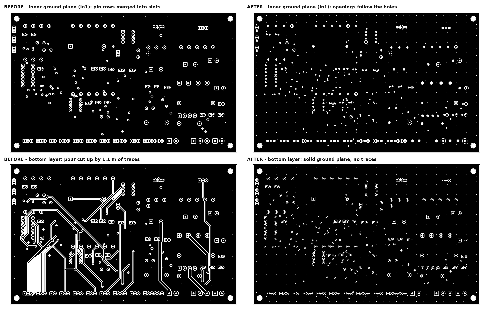
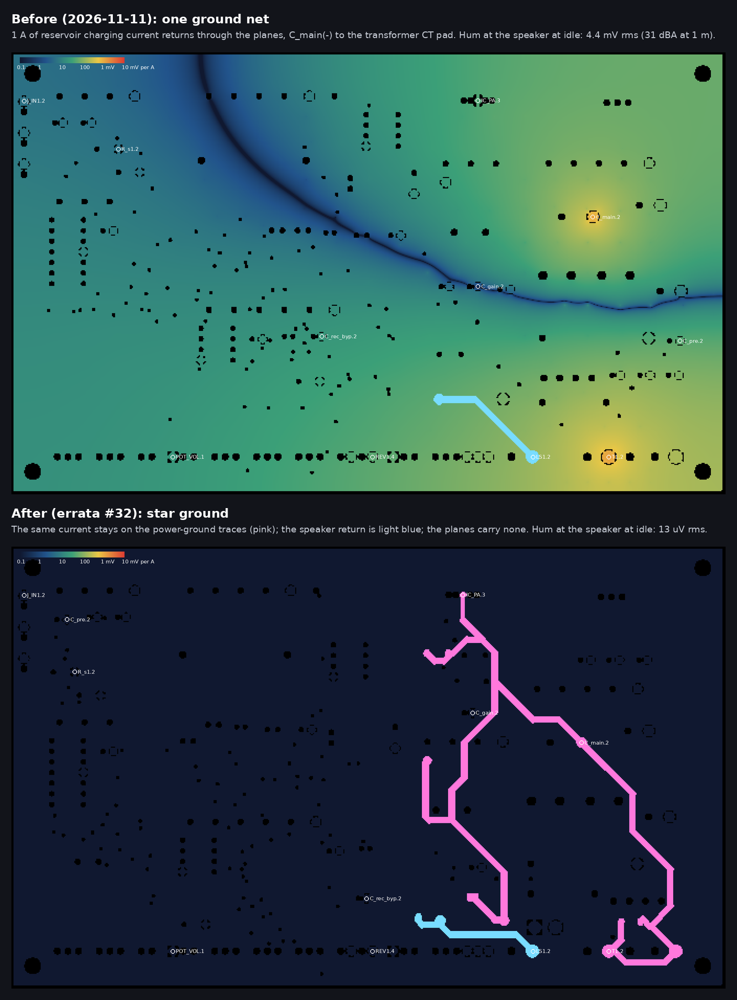
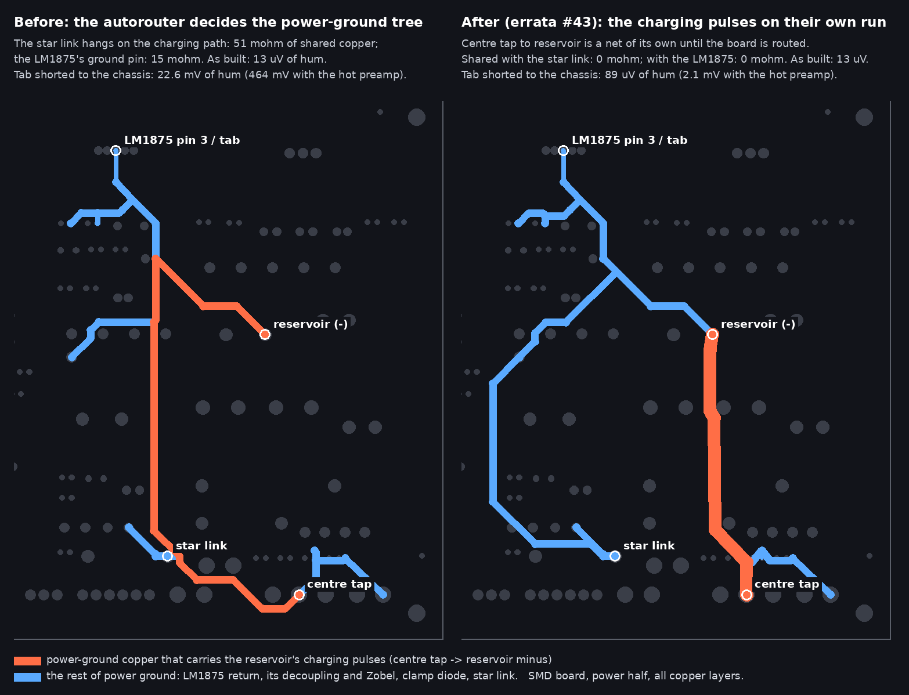

# Vox Cambridge Reverb — Errata & Sanity Check

> Reconstructed document — see `PROVENANCE.md`. The original errata listed 17
> cross-document inconsistencies. Issues 1–8 below are recovered substantially
> verbatim. Issues 9–17 were **not** recovered verbatim; they were re-derived by
> a fresh consistency pass on 2026-06-14 (the resolutions are newly authored, the
> reconciled values are recovered). The three HIGH-severity items (Issues 4, 7,
> and the JFET/MRB items) are folded into the relevant reconstructed docs.

## Issue 1 — Part 1 referenced external FX-loop / headphone jacks
The user keeps the original panel with no new holes. FX loop must be internal-only
(IN3 repurposing); headphone output removed; MRB internal-only.
**Severity:** MEDIUM. *(Folded into Part 1 §7.)*

## Issue 2 — Part 1 key-improvements list mentioned external features
Change to: internal FX-loop provision (IN3), on-board tremolo rate LED
(diagnostic, not panel), remove headphone output.
**Severity:** LOW.

## Issue 3 — Bridge rectifier naming (KBU4M vs KBP410G)
Both are 4A/1000V; different packages (KBP410 inline 4-pin, KBU4M SIP 4-pin).
PCB footprint should accommodate both. Part 8 prefers KBP410G for availability.
**Severity:** LOW.

**Update (2026-09-06):** the board now carries a real, datasheet-derived
**KBP footprint** (`cambridge_reverb:Bridge_KBP_P3.81mm`, from Diodes DS39310
KBP404G–KBP410G: 3.81 mm pitch, 0.86 × 0.55 mm leads → 1.2 mm drill, 14.5 × 3.5 mm
body, pins **+ ~ ~ −** as marked). The schematic bridge symbol was renumbered to
that physical order (pin 1 = +, 2 = ~, 3 = ~, 4 = −) so pad and pin numbers agree.
One footprint **cannot** accommodate both parts: KBU is 5.08 mm pitch, and
overlapping the two hole patterns would put holes 1.27 mm apart (violates the
0.25 mm hole-to-hole rule). To build with a KBU4M instead, swap the `BRIDGE`
footprint in `kicad/gen/gen_kicad.py` for a 5.08 mm-pitch one and regenerate.

## Issue 4 — Part 2 listed 2N5457 TO-92 (discontinued) — HIGH
Through-hole 2N5457 is discontinued; the Mouser P/N would show no stock. Primary
options are MMBF5457 on adapter or J113; keep 2N5457 only "if you find genuine."
**Severity:** HIGH. *(Folded into Parts 1, 2, 8.)*

## Issue 5 — Part 1 listed TIP41C/TIP42C discrete output as an option
The rest of the suite assumes the LM1875 as the sole power amp. Clarify the
discrete stage is reference-only, not developed (no BOM/SPICE/wiring).
**Severity:** MEDIUM. *(Folded into Part 1 §3.)*

## Issue 6 — Part 1 mentioned LM13700 OTA tremolo modulator
No BOM/SPICE/wiring exists for it; LED/LDR (VTL5C1) is used throughout. Note as
an undocumented advanced alternative.
**Severity:** LOW.

## Issue 7 — Part 2 said 2200µF output cap was "only for discrete output" — HIGH
The LM1875 in single-supply mode ALSO requires the 2200µF output coupling cap.
Remove the qualifier.
**Severity:** HIGH. *(Folded into Part 2 BOM + Part 1 §3.)*

## Issue 8 — Part 1 §6 described MRB with a panel rotary switch
Implies a new panel control. Default is hardwired 600 Hz; any selector is
internal-only (inside chassis or repurposing the line-reverse switch).
**Severity:** MEDIUM. *(Folded into Part 1 §6.)*

## Issues 9–17 — consistency pass (2026-06-14)

The original Issues 9–17 were not recovered verbatim. Rather than leave them as
a stub, the topics flagged in the project record were re-derived by a fresh
cross-document consistency pass over the *reconstructed* docs, the BOM, the
SPICE netlist, and `kicad/netlist-notes.txt`. These resolutions are **newly
authored** (not recovered originals); the underlying values they reconcile are
recovered. Re-verify before fabrication.

## Issue 9 — Board dimensions: 190×115 vs 155×90 mm
Part 4 (and the Part 5 floor plan) use **190 × 115 mm** to match the original
25-5274-2 footprint; Part 7 recommends **155 × 90 mm** as a measure-first "safe
bet." These are not contradictory — the outline is a measurement-gated decision
point, not a fixed value. **Resolution:** measure the chassis (Part 7 procedure),
then set `Edge.Cuts` to the largest size your measured chassis supports; default
to 155×90 only if you cannot measure. Both numbers are intentionally retained.
**Severity:** MEDIUM (decision point — must be closed before the PCB outline is final).

## Issue 10 — 17 V rail: LM317 set resistors yield 16.9 V, below the stated 17.0–17.5 V band — re-verify
Part 2 specifies `R_reg1 = 240 Ω`, `R_reg2 = 3.0 kΩ`. With the LM317
(`Vout = 1.25 × (1 + R_reg2/R_reg1)`, I_adj negligible) this gives
**1.25 × (1 + 3000/240) = 16.88 V** — about 0.13 V *below* the 17.0–17.5 V
window quoted in Part 2 §setup and the Part 3 troubleshooting table.
**Resolution:** either (a) accept ~16.9 V and widen the stated window to
**16.8–17.5 V**, or (b) to actually land in 17.0–17.5 V, use `R_reg2 ≈ 3.09 kΩ`
(E96 → 17.34 V) or 3.01–3.07 kΩ. Recommended: **R_reg2 = 3.09 kΩ (E96)**.
**Severity:** MEDIUM.

## Issue 11 — Net-class table is missing a high-current (speaker/PA) class
Part 4's net-class table defines only **Default (0.30 mm)** and **Power
(1.50 mm)** and assigns +33V5/VREG_IN/+17V/GND/SPK_P/SPK_N all to Power. But the Part 4
pre-order checklist *and* `netlist-notes.txt` both call for **2.5 mm** on the
speaker / power-amp current path. The single 1.5 mm Power class can't satisfy
that. **Resolution:** add a third **HighCurrent (2.50 mm)** class for
`+33V5`, `SPKR+`, `SPKR-`, and the LM1875 output; keep **Power (1.50 mm)** for
`VREG_IN`, `+17V`, `GND`. This three-class split is encoded in
`kicad/cambridge_reverb.kicad_pro`.
**Severity:** MEDIUM.

**Update (2026-09-06):** `VRAW` (bridge output → fuse → `C_main`) and the
transformer secondary nets `AC1`/`AC2` carry the same current as `+33V5` (more,
as RMS: rectifier charging pulses) but had fallen into the 0.5 mm Default class.
They are now in **HighCurrent** too (`.kicad_pro` pattern list).

**Addendum (SMD variant, 2026-09-06):** `kicad/smd/cambridge_reverb_smd.kicad_pro`
uses **HighCurrent 2.0 mm / Power 1.0 mm** (0.25 mm clearance) instead of 2.5 / 1.5.
The wider classes were sized for the 190×115 THT board; on the 155×90 mixed-SMD
board they cannot pass between 0805/1206 pads and starved the router. Electrically
2.0 / 1.0 mm on 1 oz copper carry several amps — ample for ~1.7 A peak / <1 A RMS.

## Issue 12 — Via-drill specs disagree between Part 4 and netlist-notes
Part 4 design rules give min via drill **0.3 mm** and a Power-class via drill of
**0.5 mm**; `netlist-notes.txt` instead says **signal vias 0.5 mm**, **power
vias 1.0 mm**, **ground-stitch 0.8 mm**. **Resolution** (reconciled, encoded in
the `.kicad_pro`): Default via **0.4 mm drill / 0.8 mm dia**; Power via
**0.8 mm drill / 1.4 mm dia**; HighCurrent via **1.0 mm drill / 1.6 mm dia**;
ground-stitch vias **0.8 mm**. All are ≥ JLCPCB minimums and surcharge-free.
**Severity:** LOW.

## Issue 13 — Signal trace width: 0.30 mm (net class) vs 0.50 mm (netlist-notes)
Part 4's Default net class is 0.30 mm; `netlist-notes.txt` suggests 0.50 mm for
signal. Both pass DRC and exceed JLCPCB's 0.127 mm minimum. **Resolution:** adopt
**0.50 mm** as the working signal default for hand-assembly robustness (more
copper, easier rework); the net-class minimum stays 0.30 mm so tight spots are
still legal. Encoded in the `.kicad_pro` Default class.
**Severity:** LOW.

## Issue 14 — Reverb-pan part number consistency — confirmed, no action
Cross-checked Part 1 §4, Part 9, and `bom/bom.csv`: all specify the
high-impedance **Accutronics 4FB2A1C (~1475 Ω)** and all explicitly flag the
8 Ω-input **4AB3C1B as incompatible** with the direct TL072 driver. Consistent
across every document. **No change required.**
**Severity:** NONE (verified consistent).

## Issue 15 — JFET bias values across Part 2 and netlist-notes — consistent; preamp SPICE absent
Part 2's preamp self-bias (`R_g = 1 MΩ`, `R_d ≈ 10 kΩ`, `R_s ≈ 2.2 kΩ`,
`C_s = 10 µF`) matches the reverb-recovery JFET in `netlist-notes.txt`
(`R_rec_bias = 1 MΩ`, `R_rec1 = 10 kΩ`, `R_rec2 = 2.2 kΩ`, `C_rec_byp = 10 µF`).
**Caveat:** only the *power-amp* SPICE netlist was recovered, so there was no
preamp/recovery SPICE to cross-check the bias point against.

**Update (ngspice, 2026-06-14):** a preamp sim now exists
(`spice/dc_preamp_jfet.cir`). With a nominal 2N5457 (Idss ≈ 3 mA, Vp ≈ −1.8 V),
the recovered `R_s ≈ 2.2 kΩ` / `R_d = 10 kΩ` bias the **drain at ~12 V**
(Id ≈ 0.49 mA) — *colder* than the 8–9 V target in Part 2/Part 3. Simulated fix:
**R_s ≈ 1.0 kΩ → Vd ≈ 8.5 V**, **R_s ≈ 1.2 kΩ → Vd ≈ 9.5 V**. The 2N5457 has a
wide Idss/Vp spread, so treat R_s ≈ 1–1.2 kΩ as the nominal and **trim per device
on the bench**. The BOM keeps the recovered 2.2 kΩ with this note.
**Severity:** LOW (bias trim) — but verify before relying on the stated 8–9 V.

## Issue 16 — Main filter cap: 4700 µF (Part 2) vs 2× 2200 µF split (Part 7)
Part 2's BOM gives **C_main = 4700 µF/50 V**; Part 7 notes the original ~5000 µF
cap was chassis-mounted and suggests **2× 2200 µF side-by-side** *only if* you
PCB-mount it and vertical clearance to the control panel is tight. Not a conflict
— 4700 µF is canonical; the 2× 2200 µF is a mechanical fallback. **Resolution:**
BOM keeps 4700 µF; clearance check in Part 7 decides whether the split is needed.
**Severity:** LOW.

## Issue 17 — "Bypass on each supply pin" wording vs single-supply reality
Part 1 §3 says "100 nF + 10 µF on **each** supply pin." In the single-supply
LM1875 design, V− (pin 3) **is** ground, so the bypass pair lands on **V+ (pin 5)
only**, exactly as Part 2 and the netlist show (`C_byp1`, `C_byp2` on pin 5 → GND).
**Resolution:** read "each supply pin" as "the V+ supply pin"; no extra parts.
**Severity:** LOW (wording).

## Issue 18 — JFET symbol pin numbers did not match the TO-92 / SOT-23 parts (2026-09-06) — HIGH
The generated schematic's JFET symbol numbered its pins **1 = Drain, 2 = Gate,
3 = Source**, and the board used the stock `TO-92_Inline` footprint with pads 1-2-3
in a row. The onsemi datasheets for **both** specified parts number the leads
**1 = Drain, 2 = Source, 3 = Gate** — 2N5457/J113 (TO-92, straight-lead) and
MMBF5457 (SOT-23) alike — so a real part fitted to the old board would have had
its gate on the source pad and vice-versa (Q1, Q2, Q_rec). ERC/DRC cannot see
this; it was caught while adding the SOT-23 footprint for the mixed-SMD variant.
**Resolution:** symbol renumbered to 1 = D, 2 = S, 3 = G; all three JFET net maps
updated; both boards regenerated. If you populate the THT board with a SOT-23 on a
TO-92 adapter, wire the adapter D-S-G to pads 1-2-3.
**Severity:** HIGH (silent wiring fault) — fixed in the generator; verify against
the datasheet of whatever JFET you actually buy (J113: also D-S-G).

## Issue 19 — The tremolo LFO as recovered cannot run at tremolo rates (2026-09-07) — HIGH
The recovered Wien-bridge LFO put the speed pot in **one** arm only: series arm
`R_lfo_ser` 10 k + `POT_SPD` 0–500 k with `C_lfo1` 100 nF, shunt arm a fixed
`R_lfo1` 33 k with `C_lfo2` 100 nF, amplifier gain 1 + 10 k/4.7 k = 3.13. For an
asymmetric Wien network the loop only starts when gain > 2 + R1/R2, i.e. while the
series arm stays under ~37 k — the bottom **5 %** of the pot — and there it runs at
**45–80 Hz** (f₀ = 1/(2π√(R1R2)C)). Everywhere else it does not oscillate at all.
Part 2's "~1 Hz to ~10 Hz" was never reachable with those values. Swept and shown
in `spice/sweep_lfo_speed_recovered.cir` (results in `spice/results/`).
**Resolution:** symmetric network with a **dual-gang 250 k lin speed pot**, one gang
in each arm, `R_lfo_ser` = `R_lfo_sh` = 15 k floors, `C_lfo1` = `C_lfo2` = **1 µF**.
The attenuation is then exactly 1/3 at every setting, the existing gain-3.13 /
diode-limited amplifier starts everywhere, and f = 1/(2π(15 k + pot)·1 µF) =
**10.6 Hz (fast) … 0.60 Hz (slow)** at constant 0.96 Vpp
(`spice/sweep_lfo_speed.cir`). The dual-gang pot goes in the original speed-pot
hole (no new holes); the original single pot is no longer reused. Alternative if
you insist on the single pot: a one-op-amp Schmitt relaxation LFO — square/
exponential waveform, harder tremolo; not adopted. `POT_SPD_A`/`POT_SPD_B` in the
schematic and BOM are the two gangs of **one** part.
**Severity:** HIGH (the effect did not work as drawn) — fixed in the generator;
both boards regenerated and re-routed.

## Issue 20 — Tone: the single "cut" pot did not match the panel, and the recovered coupling had no bass (2026-09-07) — HIGH
Two problems in the tone sheet, one recovered and one designed. **(a)** The
recovered preamp coupled Q2's drain to the tone/volume network through
`C_treble` **470 pF alone** — into the ~250 k volume pot that is a **1.3 kHz
high-pass**: no bass or low-mids at all reached the reverb, tremolo or power amp.
`C_treble` is the Vox "chime" cap; it belongs *across the top of the volume pot*
as a bright cap, not in series as the only coupling. **(b)** The Cambridge Reverb's
panel has **Bass and Treble** pots, but the designed substitute (cross-check §4)
was a Volume + single treble "cut" pot: the Bass hole had nothing to drive.
**Resolution (built design, `kicad/gen/gen_kicad.py` tone sheet):**
- `C_cpl_out` **1 µF** couples Q2D → `PREAMP_OUT` (flat to ~16 Hz into the 1 M
  bias resistor); `C_treble` 470 pF moves across the top half of the volume pot
  (bright cap: treble lift at low volume, transparent at full).
- A **passive James (Thomas-Vox style) Bass/Treble network** driven by a TL074
  buffer (`IC3`-A) and followed by a ×2 make-up stage (`IC3`-B) — the topology the
  originals used, deliberately **not** an active Baxandall: asymmetric, more cut
  than boost, a slight bright tilt at noon, both pots **250 k lin** in the original
  holes. `R_j1`/`R_j2` 10 k, `C_j1`/`C_j2` 22 nF, `R_j3` 68 k (bass ladder);
  `C_j3`/`C_j4` 2.2 nF, `R_j4` 1 k (treble ladder). Swept in
  `spice/sweep_tonestack.cir`: bass −7.5 … +4.9 dB @ 100 Hz, treble −16.5 … +5.6 dB
  @ 10 kHz, noon flat within 0.3 dB (`spice/results/`).
- A **switchable MID CUT** for honky pickups: `R_mid` 10 k then a series-resonant
  shunt to mid-rail — `C_res` 22 nF + a gyrator (`IC3`-C, `R_gL` 4.7 k, `C_gg`
  1.8 nF, `R_gg` 220 k → L = 1.86 H). **−9.6 dB at ~800 Hz, Q ≈ 0.6** (broad:
  −3 dB from ~400 Hz to ~1.7 kHz), flat within 0.05 dB when off. `SW_MID` is an
  SPST mini toggle in the **original line-reverse switch hole** (that position
  was reserved for "internal repurposing" in Issue 8 — no new holes). The switch
  sits on a node at mid-rail DC on both sides, so it does not pop.
- `IC3`-D buffers the result into the volume pot; `TONE_OUT` still feeds the
  summer, the tank driver and the FX send as before. `IC3` gets its own mid-rail
  (`VBIAS_3`, split-bias policy) and a DIP-14 socket; test points `TMK`
  (make-up output) and `VB_3` join the strip.
**Severity:** HIGH ((a) alone made the amp sound like a treble-only transistor
radio) — fixed in the generator; both boards regenerated and re-routed. The
"designed substitute" wording in cross-check §4 is superseded.

## Issue 21 — Hum and hiss: the LM1875 bias divider had no bypass, and the LM317's noise reached the JFETs (2026-09-07) — HIGH
Found by the first noise / hum models (`spice/ac_hum_psrr.cir`, `spice/noise_frontend.cir`,
Part 6c). **(a) Hum.** The power-amp input was biased by `R_bias1`/`R_bias2` (22 k/22 k
from +33V5) with the LM1875's + input sitting *on* the divider node and no bypass
capacitor: half the rail ripple went straight into the amplifier, ×23, to the speaker —
**+4 dB ripple-to-speaker, 0.4 Vrms of 100 Hz at idle (−28 dB below full power)**. Fix:
the textbook single-supply network — divider node bypassed by `C_bref` **100 µF**, then
`R_bias3` **22 k** into the + input (input impedance unchanged, LF corner 7 Hz with
`C_in_pa`): **−58 dB**, 0.3 mV. **(b) Hiss.** The LM317 puts out ~510 µV rms of noise
(TI: 0.003 % of V_out, 10 Hz–10 kHz) and the JFET common-source stages have ~0 dB PSRR,
so the regulator — not the JFETs — set the preamp noise floor, **23 dB above** the JFETs'
own: input-referred 37 µV rms, SNR 34 dB at 12 W. Fix: `C_adj` **10 µF** on the LM317 ADJ
pin (TI: ripple rejection 65 → 80 dB, noise ÷ ~10) and an RC-decoupled rail for the
three JFET stages, `R_pre` **100 Ω** + `C_pre` **220 µF** (`+17V_PRE`, 7 Hz corner) —
EIN 2.7 µV, SNR 57 dB, hum path B −95 dB. Four cheap parts. **Severity:** HIGH (the amp
would have hummed audibly at idle and hissed like a much worse design).

## Issue 22 — Tremolo had no depth: the vactrol LED ran at 7 mA DC (2026-09-07) — HIGH
`spice/tran_tremolo_depth.cir` (a behavioural VTL5C1 added to the errata #19 LFO) shows
the tremolo as drawn: the LFO output sits at the 8.5 V mid-rail with a ±0.5 V swing
(1N4148 limiter), and the vactrol LED was returned to **ground** through 1 k — so it
carried **6.4–7.4 mA DC**, the LDR sat at ~1 kΩ, and the "tremolo" was a permanent
**−19.5 dB pad with 1.7 dB of wobble**. The rate LED (2.2 k to ground) glowed steadily
for the same reason. Fix: the limiter diodes become two antiparallel **red LEDs** across
`R_lfo_fb1` (knee ~1.6 V → **2 V** LFO swing; `LED_rate` is one of them and now really
blinks; `LED_lim` is the other; `D_lfo1`/`D_lfo2`/`R_led_diag`/`R_led` are gone) and the
vactrol LED gets a driver: `Q_trem` (2N3904; MMBT3904 on the SMD board, on a SOT-23
footprint renumbered to the TO-92's E-B-C order) as an emitter follower, AC-coupled from
the depth pot by `C_drv` **100 µF** into a **180 k/10 k** base bias (~0.9 V, just below
conduction), `R_e` **470 Ω**, vactrol LED from +17 V via `R_c` **100 Ω** in the collector.
Result: LED 0…4.7 mA at the LFO rate, LDR 1.9 k…50 MΩ, **15 dB depth**, 0.8 dB insertion
loss. The LM317 sees ≤ 6 mA more at the LFO peak (Part 6c §5). **Severity:** HIGH (the
effect did not work); the depth pot and the footswitch tap are unchanged.

## Issue 23 — Fab rules: two footprints under JLCPCB's annular-ring minimum; assembly cost knobs (2026-09-07) — MEDIUM
Checking both boards against JLCPCB's published 2-layer limits (Part 4, updated): the stock
`TO-92_Inline` (1.05 mm pads on 0.75 mm holes) has a **0.15 mm** ring and the project's
LM1875 footprint (1.45 mm pads on 1.1 mm holes) **0.175 mm** — both under JLC's 0.18 mm
absolute minimum (0.25 recommended). Fixes: JFETs and the new `Q_trem` on
`TO-92_Inline_Wide` (2.54 mm pitch — which also matches the SOT-23→TO-92 adapters —
1.5 mm pads, 0.35 mm ring); LM1875 pads 1.5 × 2.6 mm (0.20 mm ring; the 1.7 mm pitch
cannot give 0.25 without a 1.0 mm drill that the 0.97 mm lead diagonal would not
survive — JLC's absolute minimum is met, the recommendation is not, and it is stated on
the footprint). Both `.kicad_pro` files now carry the JLC limits as DRC constraints
(hole-to-hole 0.5, hole-to-copper 0.3, annular 0.18, mask dam 0.1, silk 0.15 / 1.0 mm),
so the check is automatic. Cost: on the assembled SMD board the price is driven by
part **types** (an "extended" library part costs $3 per type per order) rather than
board area, so the 1210 capacitor line (an extended part) is folded into 1206, the two
optional MRB caps are marked **DNP** (not placed, not in the assembly BOM), and the
gyrator moves to E24 values (2.2 nF / 180 k, same 1.86 H): 31 → 29 lines, 7 → 3
extended types (`kicad/gen/jlc_cost.py`; the MMBF5457, the 3.09 k E96 set resistor and
the 68 nF MRB cap). Three fiducials were added for the
pick-and-place camera. **Severity:** MEDIUM (a fab would have flagged the rings or
produced breakouts; the rest is money).

## Issue 24 — Layout: traces threaded between component leads; no RF reference plane (2026-09-08) — MEDIUM (design change)
The two-layer boards routed the way two-layer boards do: signal traces between the legs of
resistors, under DIPs, beside the toroid, and the bottom "ground plane" was a pour
sliced by every jumper — the first crosstalk audit (Part 6c §4) put the reverb drive
0.3 mm from the reverb return and the power-amp output 0.25 mm from the recovery gate.
Resolution (`kicad/gen/gen_pcb.py`, `route_board.py`, both boards):
- **Four copper layers** (JLCPCB JLC04161H-7628, 1.6 mm): F.Cu signal — **In1 solid GND
  plane** — In2 inner signal layer — B.Cu signal with a GND pour. Every F.Cu / In2 trace
  now sits 0.21 mm from the GND plane instead of 1.5 mm: trace-to-trace coupling falls
  ~10× and the plane is a real RF/EMI reference and return. Perimeter **GND stitching
  vias** every 15 mm tie the B.Cu pour to the In1 plane (Part 4's rule, now generated).
  In2 was a +17 V plane in the first cut; with the keepouts below, two routing layers left
  33–43 links open on the THT board, so In2 routes signals (under the plane) and +17 V is
  a 1.0 mm Power trace — `IN2_PLANE = "+17V"` in `gen_pcb.py` restores the plane.
- **No routes through footprints.** For every real part the generator writes rule areas
  (no tracks / vias, F.Cu + B.Cu) over the space *between* its pads — the strips between
  the pins of a row and the body between two rows, across the full courtyard. A trace can
  reach any pad from outside; it can no longer pass between the legs of a resistor, under
  an IC, or through the MRB toroid. The router sees them as Specctra keepouts; KiCad DRC
  checks them.
- **Rules by impedance.** New `HiZ` net class (0.3 mm, 0.3 / 0.25 mm clearance) for the
  high-impedance nodes — JFET gates and the RF nodes ahead of them, the tank return, the
  tone ladder and wipers, the LFO timing nodes, the MRB tank, the LM1875 + input; `Power`
  (1.0 / 0.8 mm) for the rails, `HighCurrent` (1.5 mm — 1 oz copper carries ~2.5 A at that
  width, the amp peaks at 1.7 A; Part 4's 2.5 mm was sized for a two-layer board with no
  plane) for PA_OUT / ZOB / SPK / +33V5 / VRAW / AC; `Default` = low-impedance signal
  (op-amp outputs, drains). `.kicad_dru`: HighCurrent ≥ 0.6 mm from any signal trace,
  tank drive ≥ 0.8 mm from the return (SMD board: 0.4 / 0.6), tracks and vias only; the
  router is given the same numbers per class. On the 0.21 mm plane spacing, 0.6 mm
  couples like ~2 mm did on the two-layer boards; a wider first attempt (1.0 mm / 0.5 mm
  HiZ) left ~70 links open because a 0.5 mm clearance cannot enter a DIP pin between its
  neighbours.
- **RF stoppers** at the two antennas: `R_rf1` 1 k + `C_rf1` 100 pF at Q1's gate (guitar
  cable) and `R_rf2` 1 k + `C_rf2` 100 pF at the recovery JFET's gate (tank cable) —
  1.6 MHz corners, nothing at audio, 4 nV/√Hz against the pickup's own 10.
**Board size:** the SMD variant grows from Part 7's 155 × 90 to **170 × 100 mm** (1.0 mm
part gap): at 0.5 mm no ground / rail via fitted beside an SMD pad and 30 of 52 links
stayed open; 170 × 100 still fits any chassis the 190 × 115 original did (Issue 9).
**Cost:** a 4-layer 170 × 100 / 190 × 115 board is area-priced above JLC's $7 100 × 100 mm
tier (Part 4). **Severity:** MEDIUM — the two-layer boards worked on paper; this is the
layout a low-noise guitar amp should have.

## Issue 25 — Diode, LED and vactrol pads were numbered against their footprints (2026-11-11) — CRITICAL
The generator's `D` and `LED` symbols were numbered **1 = anode, 2 = cathode**. Every KiCad
diode footprint the boards use — `D_SMA`, `D_DO-41_SOD81`, `LED_D3.0mm` — follows the
library convention **pad 1 = cathode** (the silk bar, the printed "K", the LED's flat). So
on both boards the anode net sat on the pad *marked* as the cathode. Built to the
silkscreen — or placed by JLCPCB, whose machine follows the footprint — the two output
clamps `D1` / `D2` would have gone in backwards: forward-biased from `+33V5` through
`PA_OUT` to GND, a short across the 33.5 V rail through two 1 A diodes. ERC and DRC are
both blind to this (a net on a pad is a net on a pad); the JFET version of the same
mistake was errata #18.

The vactrol had the same fault and a second one. The PerkinElmer drawing
(`datasheets/VTL5C1_VTL5C2_PerkinElmer_Vactec.pdf`, p. 43) numbers **pin 1 = LED
cathode**, pin 2 = anode, 3 / 4 = photocell; the symbol had 1 = anode. And the footprint
was four pads in a row on a 2.54 mm pitch, where the part is **axial**: the LED leads leave
one end (1–3 mm apart), the cell leads the other end (5.08 mm apart), with a 9.1–9.9 mm
body between them.

Fix: `D` / `LED` renumbered to the KiCad convention (1 = K, 2 = A) with the nets swapped to
match; `VTL5C1` symbol renumbered to the datasheet and the footprint redrawn — LED pads
2.54 mm apart at one end, cell pads 5.08 mm apart 15.24 mm away, 1.0 mm drills (the LED
leads are up to 0.64 mm square), "K" on the silk beside pad 1. `kicad/gen/verify.py` now
carries a hand-entered table of what every polarised pad physically is, per footprint,
straight from the datasheets, and compares it with the symbol pin wired to that pad on
the finished board — plus net-level assertions (clamp-diode direction, electrolytic
polarity against the DC operating point). **Severity:** CRITICAL — an assembled board
would have blown its fuse or its clamp diodes at first power-up, and the tremolo would
not have worked.

## Issue 26 — Centre tap and bridge "−" both on GND: each half-winding shorted through a diode (2026-11-11) — CRITICAL
The power-supply sheet wired the transformer's centre tap (`T1` pad 2, "CT") to GND **and**
the bridge's "−" pin to GND. With a centre-tapped secondary — the original transformer
("~48 VAC", Part 9) or a 2 × 24 V toroid in series — that is the classic mistake: on each
half-cycle one end of the winding swings 34 V below the tap, and the bridge's "−" diode on
that end conducts straight from GND into it, with only the winding resistance in the
loop. The intended rail (33.5 V from a 24-0-24 V secondary) is the **two-diode** full-wave
rectifier; the bridge's "−" pin must float.

Fix: the "−" pin ends on its own net `BR_NEG`; a wire link **`JP_BR`** (two 3 mm power
pads on the wiring edge, beside the transformer pads, silk "NO CT ONLY") joins it to GND.
**Default: link open** — centre tap to the `CT` pad, the bridge works as a two-diode
full-wave. Fit the link only for a transformer with a **single 24 V winding and no
tap** (a dual-secondary toroid wired in parallel), and then leave the `CT` pad empty.
Never both. `verify.py` asserts that the two are not hard-wired together.
**Severity:** CRITICAL — with the original transformer the first power-up would have been
a dead short across the secondary, limited by the mains fuse.

## Issue 27 — The footswitch switched nothing, and the MRB band-pass was permanently in the signal path (2026-11-11) — HIGH
`FS_REV` / `FS_TREM` / `FS_MRB` left the DIN connector and each ended on a 100 k
pull-down — "defined control lines so they aren't single-ended" (SCHEMATIC-BUILD). No
effect was switched by anything. Reverb and tremolo at least follow their panel pots,
but the MRB tank (`L1` ∥ `C_mrb_600`) went straight to GND: the signal passed through a
577 Hz band-pass at all times, −29 dB at 100 Hz and −10 dB at 1 kHz
(`spice/ac_mrb.cir`). There was no way to play the amplifier without it.

Fix — three switches to ground, the way the pedal's contacts work, no added active parts:
- **MRB:** the tank's ground return *is* the footswitch line. Switch closed → MRB on
  (the response above). Switch open, or no pedal → the tank floats on `R_fs_mrb` (now
  1 M, a DC return so closing the switch does not pop) and the path is flat within
  1.3 dB from 100 Hz to 5 kHz with a metre or three of pedal cable hanging on it. No
  pedal and MRB wanted: link `FS1` pads 3–4.
- **Reverb:** `FS_REV` is the recovery stage's output, the top of the reverb-level pot
  (~10 k source impedance — the lowest in the wet path, which matters for a line that
  leaves the chassis). Closed → reverb off; open → reverb on. `R_fs_rev` is gone (the
  pot is the DC return).
- **Tremolo:** `FS_TREM` is the LED driver's base. Closed → `Q_trem` off, the vactrol
  goes dark, the signal passes at full level; the LFO keeps running, so there is no
  thump and no restart delay. New **`R_qb` 1 k** between `C_drv` and the base keeps that
  short off the depth-pot wiper (without it the LFO output would be shorted through
  100 µF at full depth). Depth 15.1 → 14.1 dB; with the switch closed 0.02 dB
  (`spice/tran_tremolo_depth.cir`, cfg 2). `R_fs_trem` is gone (`R_b2` is the base
  return).

With no pedal plugged in the amp is a normal amp: reverb and tremolo on their pots, MRB
out. The pedal's own wiring was never recovered (Part 3): if a button does not short its
line to the common, rewire the button — the board side needs one contact to GND per
effect. **Severity:** HIGH — as drawn the amplifier had a telephone-band frequency
response and a dead footswitch.

## Issue 28 — 45 dB of gain ahead of the volume control (2026-11-11) — HIGH (build option, no board change)
Both JFET stages had their source resistors bypassed (`C_s1`, `C_s2`): 22 dB each, 45 dB
in front of the tone stack and the volume pot. `spice/tran_preamp_headroom.cir` drives
the two stages with a 1 kHz sine at pickup levels: **8 % THD at 20 mV peak, 35 % at
100 mV** — the second stage is overdriven by any guitar, at any volume setting. With both
bypass caps left out the preamp has 21 dB of gain and stays under 1.1 % THD up to
200 mV peak (4.7 % at 500 mV); the power amp still reaches full output from ~55 mV peak.
With only `C_s1` fitted: 33 dB, 1 % at 100 mV, 14 % at 200 mV.

Resolution: the two caps are through-hole electrolytics fitted by hand, so this is a
**voicing option, not a layout change**. They are now marked "(opt)" — do-not-place by
default — and the three choices are tabulated in `kicad/PCB-NOTES.md`. The bias trim of
errata #15 is unaffected (it is a DC matter). **Severity:** HIGH — built as drawn, a
clean amplifier would have had no clean sound.

## Issue 29 — Four controls turned the wrong way (2026-11-11) — MEDIUM
The tone pots were wired with pad 3 as the clockwise end; volume, reverb, depth and both
speed gangs had pads 1 and 3 the other way round, so wiring lug-to-pad would have given
clockwise = quieter / less reverb / shallower / slower. All seven pot footprints now
follow one rule — **pad 1 = CCW end, pad 2 = wiper, pad 3 = CW end, clockwise = more** —
and the silkscreen prints `CCW` / `W` / `CW` under the pads. **Severity:** MEDIUM
(caught at first power-up, fixed with a soldering iron — but on every board).

## Issue 30 — "Ready for JLCPCB" was not: no part numbers, no silkscreen, open links, unverified claims (2026-11-11) — MEDIUM
What the SMD board lacked to be an order, and what each item is now:
- **Part numbers.** The assembly BOM's LCSC column was empty "for the parts picker".
  `kicad/gen/jlc_parts.py` now holds one looked-up part per line — stock, class and
  package read from JLCPCB's library on 2026-11-11, re-checkable with `--check`. The
  earlier cost claim (3 extended types, ~$20 per five boards) assumed that 1206 C0G
  capacitors are basic parts; they are not, in any of the packages checked. Real count:
  **30 lines — 15 basic, 2 preferred, 13 extended**; fees ≈ $50 per five boards plus
  parts (`jlc_cost.py`). The policy that costs the money (C0G on the high-impedance and
  frequency-setting nodes, 100 V X7R on the 33.5 V rail) is argued in `jlc_parts.py`.
- **Silkscreen.** Reference designators were hidden on both boards. Every part now has
  its reference on the front silk at JLCPCB's legend minimum (1.0 mm / 0.15 mm), in a
  strip the placer reserves above it, so no label sits on a pad or under a neighbour;
  the wiring pads carry what each pad is for (`T` / `S`, `CCW` / `W` / `CW`, `IN` / `G` /
  `OUT`, `REV` / `TRM` / `MRB`, `AC` / `CT` / `AC`, `+` / `−`); the board carries its
  name and revision, and `JLCJLCJLCJLC` on the bottom silk for the order number.
- **Routing.** 216 of 226 connections, 1 DRC error. Both boards are now **fully routed
  with 0 DRC errors and 0 warnings**: Freerouting does the bulk, and a small maze router
  (`kicad/gen/finish_routes.py`) closes what it leaves — signal-level branches of power
  nets, necked down to 0.5 mm where they only feed a resistor or a test point, and the
  tank-drive nets, whose spacing rule the autorouter had to apply to everything.
- **Order package.** `kicad/gen/fab_jlcpcb.py` writes the Gerber + drill zip, the CPL in
  JLCPCB's column format with the SOT-23 rotation offset, and an assembly drawing, and
  refuses a board that is not clean.
- **Size.** The SMD board is **170 × 105 mm** (was 170 × 100): the labels, the axial
  vactrol and the link did not pack into 100 mm of height.
- **One command.** `kicad/gen/build.sh smd` rebuilds everything;
  `kicad/gen/verify.py smd` is the gate — rule checks, schematic-to-board parity pin for
  pin, the pin-function audit, the electrical assertions, the order-package consistency
  checks and the SPICE suite with a schematic-to-netlist value cross-check.
**Severity:** MEDIUM — none of it dangerous, all of it between the design and an order.

## Issue 31 — Ground system: slotted plane, a signal layer over a chopped pour, sparse stitching; scripted fills ignored the rules (2026-11-11) — MEDIUM (design change)
The question was whether the traces sit too close to the pours and lose signal to
capacitance. Measured on the board as committed (`kicad/gen/rf_audit.py`, new), the
answer to that is no — and the measurement found four other things that were wrong.

**What was not wrong.** Every pour was already 0.5 mm from every trace (a render at
board scale makes the gap look like a hairline). The capacitance that matters is the
trace over its plane, about 1 pF per cm, not the pour beside it; summed over every
sensitive net it comes to 3–26 pF, and the lowest corner any of them makes with its
node impedance is 100 kHz (the volume-pot wiper). Nothing reaches the audio band.

**What was.**
1. *The ground plane was slotted.* The In1 plane used KiCad's default 0.5 mm zone
   clearance, so each 1.6 mm pad got a 2.6 mm opening — on a 2.54 mm pitch. Every row
   of pins had merged into one slot: **31 openings longer than 5 mm, the longest
   17.8 mm, under the TL074.** Return current has to walk round a slot; that is where
   a board picks up and radiates.
2. *The inner signal layer had no plane.* JLC04161H-7628 is 0.21 mm prepreg / 1.07 mm
   core / 0.21 mm prepreg, so In2 is 0.21 mm from **B.Cu** and five times further from
   the In1 plane — and B.Cu carried 1.1 m of traces, which left its pour with openings
   up to 80 mm across. (PCB-NOTES said every In2 trace sat 0.21 mm from the GND plane.
   It sat 0.21 mm from that.) The crosstalk audit's assumption that no two signal
   layers face each other without a plane between was also false for In2 and B.Cu.
3. *Stitching was thin.* 27 perimeter vias on a 15 mm pitch with a 56 mm gap, 48 ground
   vias on the whole board, and a point 33 mm from the nearest one.
4. *Scripted zone fills ignored the project's rules.* pcbnew's filler asks the board's
   rule engine for each clearance; in a script the engine is empty until something
   initialises it, and the fill then keeps only each zone's own clearance — no net
   classes, no hole clearance, no `.kicad_dru`. It was invisible while every zone had
   a blanket 0.5 mm, and it appeared the moment the planes were tightened: 411 clearance
   errors. `route_board.refill()` now initialises the engine first (one `WriteDRCReport`
   call), so a scripted fill is what pressing B in the editor gives.

**Fix — the copper rebuilt to RF practice:**
- **Stack:** `F.Cu` signal + ground pour / `In1` solid ground / `In2` signal / `B.Cu`
  **solid ground**. Nothing is routed on a plane. Each signal layer is 0.21 mm from its
  own plane and In2 is buried between the two. Both boards still route completely on two
  signal layers.
- **Plane openings follow the holes.** Plane clearance 0.2 mm to copper and 0.35 mm to a
  hole, and the unused pad copper is removed from the inner layers (pads and vias keep a
  ring only where something connects), so the opening round a foreign pin is hole +
  0.7 mm: a 1.0 mm web survives between 2.54 mm pins. In1: **3 openings over 5 mm**
  (was 31) — the footswitch and tank pad rows, where the ground pads' own thermal
  reliefs join their neighbours, and the LM1875's 1.7 mm pin row; longest 10 mm.
  B.Cu, where pads cannot be removed: 11, all under the 2.0 mm wiring pads on the board
  edge and the LM1875; coverage 80 → 92 %, one piece.
- **Top pour:** 0.5 mm from every trace, **1.0 mm from high-impedance (HiZ) nets**
  (`.kicad_dru` rule `pour_to_hiz`, top layer only — on a plane the wider opening would
  bring the slots back), no sliver narrower than 0.4 mm.
- **Edge:** copper 0.5 mm back on all four layers, against JLCPCB's 0.2 mm from a routed
  edge that is itself ±0.2 mm (and 0.4 mm should they add V-cut rails). A **ground via
  fence every 5 mm** round the perimeter (95 vias on the SMD board; gaps only at the
  corner holes and the edge wiring pads).
- **Stitching:** every SMD ground pad gets its own via beside it before routing
  (`stitch.fanout`), and after routing ground vias go on a 7.5 mm grid wherever one fits
  on every layer, 1 mm clear of any pad (`stitch.py`): **326 ground vias (was 48), no
  point further than 14 mm from one (was 33), mean 3.3 mm.**
- **Through vias only.** Shown two layers, the autorouter returns vias that span just
  those two — blind vias, which the standard process does not drill. The drill-count
  check in the order package caught 75 of them; `route_board.py` now makes every via a
  through via, and `fab_jlcpcb.py` / `verify.py` refuse a board with any other kind.
- **The one node where a few pF do matter.** The reverb summer's three 100 k resistors
  meet at `SUMJ`; 10 pF there (op-amp input + socket + 6 pF of copper) puts a pole
  inside the feedback loop and the stage peaks **5.3 dB at 620 kHz**
  (`spice/ac_summer_stability.cir`). New **`C_mixfb` 33 pF C0G** across `R_mixfb`: no
  peaking for 5–25 pF of stray, −0.09 dB at 7 kHz, −0.7 dB at 20 kHz.
- **JLCPCB's limits re-read** from their capability page and applied where the project
  was looser: hole-to-copper 0.30 → 0.35 mm, annular ring 0.18 → 0.20 mm, silkscreen
  text 0.15 mm off every pad (rule `silk_to_pad`). Part 4 has the table.
- **Completion router:** routes short links first and, if a link finds no path, starts
  again from the autorouted board with the failed links first (two routing layers leave
  less room for a fixed order); treats an unconnected through-hole pad on In2 as the
  hole it now is; signal links fall back to 0.3 mm before giving up.

`verify.py` gained the "RF rules" and "JLCPCB limits" groups (64 checks on the SMD
board, 55 on the THT board). Crosstalk after re-routing, now with the tank driver's
own output counted as an aggressor: worst pair `R_DRVO` → `TANK_OUT` −61 dB (SMD),
`R_DRVO` → `DRVP` −75 dB (THT). **What this is not:** an impedance-controlled board.
No trace here is long enough to be a transmission line below a gigahertz, and none
needs to be; the point of the exercise is a ground that stays one ground at radio
frequency, so that what arrives on the guitar, tank, pedal and speaker cables finds a
short way home instead of a detour through the audio path.
**Severity:** MEDIUM — the old copper would have worked as an audio board; it would
have been needlessly open to hum fields and radio pickup, and three of the four
defects were invisible to DRC.

## Issue 32 — One ground net: the reservoir's charging pulses and the speaker current ran through the planes the preamp is referenced to (2026-11-12) — HIGH (design change)
A ground plane is not an equipotential. The rectifier refills `C_main` in pulses
(0.7 A peaks at idle, 3 A at full power), and they returned from the reservoir's
negative pin to the transformer's centre-tap pad **through the planes, 57 mm
apart**; the loudspeaker current took the same copper from `R_spk_rtn` to the reservoir
and to the LM1875's ground pin. Part 3 has always said "single star-ground point near
C_main … all ground returns land at the star"; the board never had one.

New tool **`kicad/gen/ground_audit.py`**: it rasterises the routed ground copper of all
layers, joins them through every via and solves the resistor network (finite
differences, 738 000 nodes). For each current loop it reports the voltage that appears
*between the two ground references of each stage*, multiplies by that stage's gain to
the speaker (from `spice/results/`), and sums — with a time-domain rectifier model for
the pulse spectrum. On the boards as committed on 2026-11-11:

| | SMD board | THT board |
|---|---:|---:|
| Buzz at the speaker at idle, standard build | **4.4 mV rms** (31 dBA at 1 m) | **7.4 mV** (36 dBA) |
| … with `C_s1` / `C_s2` fitted | 6.9 mV (35 dBA) | 23.9 mV (46 dBA) |
| Speaker current → ground drop → back into the amplifier: loop gain | -49 dB | -42 dB (-31 dB with the bypass caps) |
| LM1875 0.1 µF decoupling / Zobel, distance from the IC | 66 / 62 mm | 71 / 62 mm |

Largest shares: the reverb recovery stage (tank return pad against the JFET's source
bypass, ×575 to the speaker) and the preamp rail filter `C_pre`, whose negative pin sat
in the power-supply corner although a resistor-loaded JFET stage has no supply rejection
— wherever that pin is, is the reference of Q1's and Q2's output.

**Resolution** (both boards):
- **Three ground nets.** `PGND` (power ground: T1 centre tap, `JP_BR`, `C_main` −,
  snubbers `C103`/`C104`, LM1875 pin 3 with `C_byp1`, `C_byp2`, `C_zobel`, `D2`),
  `SPK_N` (the speaker's return pad) and `GND` (everything else = the planes). `PGND`
  and `SPK_N` are 1.5 mm traces. `R_spk_rtn` (0 Ω) links `SPK_N` to `PGND`; the new
  **`R_gnd` (0 Ω) links `SPK_N` to the planes — the star.** The planes take their
  reference from the speaker's own "−" terminal, so no drop on the power ground is in
  series with anything. The star is in the netlist, not in the placement: however the
  router lays the traces, the pulses have no path through `SPK_N` or `GND`.
- **LM1875 parts at the LM1875** (data sheet: "as close as possible"): `C_byp1`,
  `C_zobel`, `R_zobel`, `C_byp2` lead the packing order of the power-amp zone, on the
  SMD board also the feedback and input-filter parts and the LM317's set resistor and
  capacitors (`gen_pcb.CLOSE`). Pin 3 gets its own escape stub on the inner signal layer.
- **SMD board: `R_pre` / `C_pre` move to the preamp** (`SHEET_OVERRIDE_BY_PROFILE`), and
  the reverb op-amp's feedback and summing parts sit directly beside it
  (`NEAR_BY_PROFILE`): height-class sorting had put them 35–40 mm away behind four
  electrolytics — a long inverting-input node, and tank-drive nets the routers could
  no longer get across the column. Worst crosstalk pair on the re-routed board:
  `R_DRVO` → `SUMJ` **−84 dB** (was `R_DRVO` → `TANK_OUT` −61 dB).
- A chassis-bond pad pair `J_CHS` on signal ground (SMD board) and a `PGND` test point.

| After | SMD board | THT board |
|---|---:|---:|
| Buzz at the speaker at idle, standard / with bypass caps | **13 µV / 22 µV** | **31 µV / 82 µV** |
| Loop gain through the ground copper | none dB | none dB |
| `C_byp1` / `R_zobel` from the IC | 20 / 15 mm | 25 / 25 mm |

*The signal-ground plane under 1 A of reservoir charging current, colour = microvolts
against the power amp's feedback ground. Before: a gradient across the whole board.
After: the current stays on the power-ground traces (pink); the plane is flat.*

`verify.py` has a new "grounding" group: the three nets are bridged by exactly the two
0 Ω links, the heavy returns are on `PGND`, no plane carries anything but `GND`, the
audit's hum and loop-gain figures are inside limits, the decoupling is at the IC.
**What the audit is not:** a field solver or a measurement. It is a DC sheet model with
simulated gains and a resistive transformer; it compares layouts and gives an order of
magnitude. Magnetic pickup from the transformer and chassis loops are outside it.
**Severity:** HIGH — an audible buzz that no amount of filtering would have removed,
and on the THT board enough ground feedback to matter with the hot preamp option.

## Issue 33 — F1: a 1 A fuse in a path that carries 1.1–1.5 A rms (2026-11-12) — MEDIUM
`F1` sits between the bridge and the reservoir, so it carries the charging pulses, not
the average rail current. The rectifier model in `ground_audit.py` (24-0-24 V, 2.8 Ω per
half winding, 4700 µF): 0.24 A rms at idle, **1.11 A rms at full sine power (0.64 A
average), 1.54 A rms driven into clipping.** A T1A fuse runs above its rating exactly
when the amplifier is played hard and fails after hours, not seconds — the kind of fault
that reads as "the amp died at the gig". (The roast, R5, already called it marginal.)
**Resolution:** `F1` = **T1.6A 250 V time-lag** (5 × 20 mm; silkscreen note updated).
That is 69 % loading at full sine power, and it still opens at about 110 % of the 50 VA
transformer's secondary rating; a short behind it draws over 8 A and clears it at once.
**Severity:** MEDIUM — nuisance blowing; no hazard either way.

## Issue 34 — LM317 set resistor: errata #10 "corrected" 3.0 kΩ to an E96 value the regulator cannot resolve (2026-11-12) — LOW
Issue 10 computed 1.25 × (1 + 3000/240) = 16.88 V, found it 0.13 V under the
"17.0–17.5 V" quoted in Part 2, and specified 3.09 kΩ (E96). Two things were missing:
the adjust-pin current (50 µA typ, × 3.0 kΩ = +0.15 V, so the original value gives
**17.03 V** typical), and the reference tolerance (1.20–1.30 V): any LM317 lands between
**16.4 and 17.7 V** whichever of the two resistors is fitted. The E96 part was also the
SMD board's only 1206 resistor and an extended part of its own.
**Resolution:** `R_reg2` = 3.0 kΩ — on the SMD board as 2 × 1.5 kΩ 0805 in series
(`R_reg2`, `R_reg2b`: 42 mW each; one 0805 would run at 83 mW of its 125). Part 2 / 3
now quote 17.0 V typical, 16.4–17.7 V.
**Severity:** LOW.

## Issue 35 — LM1875: the 1 nF across the feedback resistor takes its noise gain to 1; the IC is stable for gains ≥ 10 (2026-11-12) — HIGH
`C_fb_hf` (1 nF across `R_fb` 22 k) set the 7.2 kHz "guitar" roll-off. It also makes the
feedback network's attenuation fall with frequency: the noise gain 1 + Z_f/R_gain is 23
in the audio band, **below 10 above 16 kHz and 1 above about 160 kHz**. The LM1875 "is
designed to be stable when operated at a closed-loop gain of 10 or greater" (data
sheet, Application Hints) — it is not unity-gain compensated, and with this network the
loop closes at its unity-gain frequency. `spice/ac_power_amp_lm1875.cir` could not see
it: a one-pole op-amp model has 90° of phase margin at any gain.

New `spice/ac_pa_stability.cir` with a three-pole model (`models/opamp3p.sub`; GBW 5.5 MHz
from the data sheet, the non-dominant poles set so the amplifier has 45° — or,
generously, 60° — of phase margin at a noise gain of 10):

| | phase margin (45° / 60° model) | loop crosses unity at |
|---|---:|---:|
| calibration: plain gain of 10 | 48° / 61° | 0.46 / 0.51 MHz |
| **as drawn: 1 nF across R_fb** | **−9° / −1°** | 1.8 / 2.3 MHz |
| resistive feedback, roll-off at the input | **+68° / +76°** | 0.23 MHz |

**Resolution:** `C_fb_hf` removed; the roll-off is an RC in front of the + input —
**`R_lp` 1 k** between `C_in_pa` and the pin, **`C_lp` 22 nF C0G** from the pin to
ground (7.7 kHz with `R_bias3`; simulated). The feedback is `R_fb` / `R_gain` and
nothing else, which `verify.py` now asserts. Side effects: 0.6 dB less gain (input
divider), and the input finally has the series resistor and shunt capacitor the same
data-sheet section recommends against RF pickup. The class-A variant schematic
(`gen_classa.py`) had the same capacitor — and still carried the pre-#25 diode pin
order — both corrected.
**Severity:** HIGH — an output stage that would probably have oscillated in the
megahertz range, cooking the Zobel resistor; the Part 3 troubleshooting table even
lists "high-frequency squeal — LM1875 oscillating".

## Issue 36 — JLCPCB assembly: 14 extended part types where 3 are needed (2026-11-12) — LOW (cost)
The 2026-11-11 part selection looked for C0G capacitors in the footprint the board
already had (1206) and found every one of them "extended" ($3.07 loading fee per part
type per order). JLCPCB's **basic** library does hold C0G 33 pF, 100 pF and 2.2 nF and a
**100 V** X7R 100 nF — in 0805. Re-selected, with every part looked up live again:

| Change | Why it is free |
|---|---|
| 100 pF, 2.2 nF, 33 pF C0G and the 100 V 100 nF X7R: 1206 → **0805** basic / preferred parts | same dielectric and rating, smaller pad |
| Snubbers `C101`–`C104` 10 nF → **100 nF** (the same 100 V part as the rail bypass) | any value from 10 to 100 nF does this job |
| `C_in_pre` 47 nF → **100 nF** C0G (existing line) | 1.6 Hz corner instead of 3.4; less of `R_g1`'s noise reaches the gate |
| `C_rev2` 10 nF → **22 nF** C0G (existing line) | 7 Hz corner instead of 16; halves `R_rec_bias`'s noise at the gate |
| `C_mrb_600` 68 nF → **3 × 22 nF** (SMD board) | the 68 nF C0G had 215 pieces in stock; 620 Hz instead of 610 |
| `R_reg2` 3.09 k 1206 → 2 × 1.5 k 0805 | errata #34 |
| `C_fb_hf` 1 nF → gone | errata #35 (`C_lp` is on the 22 nF line) |
| **`C_treble`** 470 pF: hand-fitted on both boards | no basic C0G of that value in any size; and the bright cap is the first part a player changes |

Left as extended, because nothing basic replaces them: 22 nF and 100 nF C0G, and the
JFET. **26 lines (20 basic, 3 preferred, 3 extended), 99 placed parts; assembly fees for
five boards $54 → $21, with parts about $45** (`kicad/gen/jlc_cost.py`, with JLCPCB's
price table as updated 2026-10-22). Part 2's snubber row also listed a 50 V Y5V part
number for a capacitor that sees twice the secondary peak; corrected to 100 V X7R.
The THT board keeps one 68 nF film capacitor and one 3 k resistor (and has no `J_CHS`
or `PGND` test point): it is full — the three parts this pass adds there fit only with
2.5 mm instead of 3.0 mm channels between the columns.
**Severity:** LOW — money, and two parts that could have held an order up.

## Issue 37 — The output buffer was biased from the tremolo oscillator's own reference (2026-11-12) — HIGH
Roast R6 split the mid-rail reference into `VBIAS_R` (reverb, mixer) and `VBIAS_T`
(tremolo) "so LFO current on the tremolo reference cannot modulate the reverb stage" —
and left the **output buffer**, the last stage of the audio path, on `VBIAS_T`. The LFO
pulls its own frequency on that node through `R_lfo_fb2`, the Wien shunt arm and the
depth pot: **0.7–1.0 V pp** on a 100 k / 100 k / 47 µF divider. The buffer followed it.
New `spice/tran_tremolo_thump.cir` — the whole chain to the loudspeaker at its real DC
levels, with **no audio signal**:

| | as drawn | as built |
|---|---:|---:|
| LFO at the loudspeaker, tremolo running (any depth, including zero) | **0.37 V pp** | 8 mV pp |
| Footswitch pressed, depth at minimum (`C_drv` dumps 0.9 V into the rail) | **2.5 V pp** | 5 mV pp |

**Resolution:** `R_obuf_b` returns to `VBIAS_R`. No part added.
**Severity:** HIGH — sub-audio, so not heard as a tone, but it is cone movement and
headroom at any setting with the tremolo merely switched on, and an audible thump from
the footswitch.

## Issue 38 — The vactrol's DC-blocking capacitor charged its own node while the tremolo was off (2026-11-12) — HIGH
`C_dc_blk` (10 µF electrolytic) holds off the 8.5 V of the mixer output; behind it,
`TREM_S` is tied to ground by the vactrol's LDR and nothing else. With the LED dark the
LDR is 50 MΩ, the capacitor's leakage has nowhere to go, and `TREM_S` creeps up with a
500 s time constant — to 3 V with a typical capacitor (0.1 µA), 7 V with one at its
data-sheet limit. The next time the LED lights, the LDR drops to 2 kΩ in milliseconds and
that charge goes through `R_trem1` into the audio:

| engaging the tremolo after a few minutes' pause | thump at the loudspeaker |
|---|---:|
| as drawn, typical capacitor (0.1 µA) | **8.2 V pp** |
| as drawn, leaky capacitor (1 µA) | **19 V pp** (rail to rail) |
| as built, ceramic at its worst-case insulation resistance | 38 mV pp |

**Resolution:** `C_dc_blk` = **2.2 µF 50 V X7R** (JLCPCB basic `C50254`; THT board: a
radial ceramic or box film — not an electrolytic), and **`R_tb` 220 k** from `TREM_S` to
ground. Depth 14.1 → 13.8 dB.
**Severity:** HIGH — a full-power thump from a footswitch.

## Issue 39 — Three nodes with no DC path (2026-11-12) — MEDIUM
New `kicad/gen/offset_audit.py` walks the netlist for nets that reach a defined DC level
only through capacitors. Such a node drifts, and the first switch, plug or meter probe
that pins it sends the difference through the amplifier.

| node | between | what pinned it | fix |
|---|---|---|---|
| `MIDSW` | the open mid-cut switch and `C_res` | closing the switch: up to a 5.8 V, 0.3 ms click at the tone output | `R_midb` 1 M across the switch |
| `GUITAR_IN` | the jack tips and `C_in_pre` (nothing plugged in) | plugging in a guitar, ahead of ×210 … ×5250 of gain | `R_jb` 10 M to ground (input impedance 0.9 M) |
| `MRB_OUT` | `C_mrb_out` and `C_obuf_in` | a meter on its test point | `R_mrb_b` 1 M to ground |

Part 2 said of the mid-cut switch "an audio shunt sitting at mid-rail DC → no pop"; that
holds only while something keeps the far plate of `C_res` there. The SMD board has all
three resistors. **The THT board is full** (0.05 mm of column width left): there `R_jb`
goes across the lugs of input jack 1 and `R_midb` across the lugs of the toggle switch
(Part 3), and `TP MRB` should not be probed with the volume up.
**Severity:** MEDIUM — clicks, not damage.

## Issue 40 — Ground loops through the hardware: copper under the mounting screws, live tabs, wiring that bridges the star (2026-11-12) — HIGH
New `kicad/gen/loop_audit.py`. On the board itself it finds **no closed loop** in the
copper of any routed net (the rings the routers do leave now and then — 30 mm² in
`VBIAS_R`, 37 mm² in `TANK_IN`, 11 mm² at the reverb driver's output on three fresh
routings — are opened by the new ring step in `tidy_tracks.py`), and the big current
loops are small:
reservoir charging 5.2 cm² on the SMD board (11.4 on the THT board) =
0.02 µT at 10 cm, against the 1 µT and more of the mains transformer itself.
The loops are in the **hardware and the wiring**:

- **Ground copper ran to 0.55 mm from every mounting hole, on both outer layers.** A
  screw head, a metal standoff or a washer then bears on solder mask over ground copper
  — up to four chassis bonds nobody planned. Now a copper-free land of 3.8 mm radius
  round each hole on `F.Cu` and `B.Cu` (the inner plane is not touched).
- **The LM1875's tab is its pin 3, and since errata #32 pin 3 is power ground.** Bolted
  bare to a chassis that the input jacks also ground, it bridges the star. The silkscreen
  now says `TAB = PGND: MICA + BUSHING` under the IC (and `TAB = +17V: INSULATE` under the
  LM317).
- The solver puts numbers on the mistakes — one off-board connection added to the board
  as built, same charging pulses, same speaker current (SMD board as it is now, with the
  power-ground star of errata #43; hum at the speaker, standard / hot preamp; speaker
  current fed back through the grounds, hot preamp):

| | hum | feedback loop gain |
|---|---:|---:|
| as built | 13 / 21 µV | none |
| LM1875 tab bare on the chassis | **89 / 2054 µV** | −6.1 dB |
| metal speaker jack on the chassis | **69 / 1594 µV** | −17.2 dB |
| transformer centre tap also to the chassis | **10703 / 218598 µV** | −8.2 dB |
| chassis bonded twice (jacks AND the chassis pad) | **13 / 19 µV** | none |

**Severity:** HIGH for the wiring (hum tens to thousands of times higher, and speaker
current in the input ground within a few dB of oscillation with the hot preamp option),
MEDIUM for the mounting holes.

## Issue 41 — Loops that close off the board: the reverb tank's two shields, jack sleeves, a second chassis bond (2026-11-12) — MEDIUM (design change on the SMD board)
A stray field drives a current round any closed ground loop; where that current shares
a conductor with a signal, its drop is amplified. `loop_audit.py` solves the board for a
current between each pair of off-board ground pads and adds the off-board conductor
that is in series with the signal. For a reference field of 1 µT at 50 Hz through
100 cm² of loop (3.1 µV; a toroid at 10–15 cm — an EI-core transformer is 10–50 times
that), at the loudspeaker:

| loop, if it is closed | SMD board | THT board | keep it open by |
|---|---:|---:|---|
| two input-jack sleeves joined by a metal panel | 332 µV (8310 hot) | 331 µV (8280 hot) | non-insulated jacks: ONE sleeve wire to the board (the panel joins the sleeves); insulated jacks: all three |
| input jack 1 and the FX jack sleeves joined by the panel | 336 µV (8363 hot) | 330 µV (8267 hot) | as above |
| the two reverb-tank cable shields joined at the tank (4FB2A1C: both connectors grounded) | 7 µV (7 hot) | 903 µV (902 hot) | solder only the OUTPUT cable's shield at the board (pad 4) and leave the input shield open at this end; run the two cables together |
| chassis bonded at the input jacks and again at the chassis pad | 327 µV (8008 hot) | 311 µV (8176 hot) | ONE chassis bond: the jacks if they are not insulated, otherwise the chassis pad |
| footswitch cable shield / DIN shell on the chassis | 62 µV (1442 hot) | 31 µV (1426 hot) | DIN pins 4-6 are the pedal's commons; do not tie them to the connector shell |
| volume-pot case soldered to its ground lug (case on the panel) | 54 µV (1434 hot) | 44 µV (1363 hot) | do not solder pot lugs to pot cases; the panel already holds the cases at chassis potential |
| reverb-pot case soldered to its ground lug | 46 µV (1411 hot) | 13 µV (1385 hot) | as above |

The largest by far is the **reverb tank**: the 4FB2A1C grounds both its connectors to
the tank chassis (grounding code "A"), so the two cable shields and the board are a
closed turn, and its current returns along the output cable's shield — in series with
a millivolt signal ahead of ×575.
**Resolution (SMD board):** the input-cable shield pad (`REV1` pad 2) returns to ground
through **`R_tg` 10 Ω** — 250 times the resistance of a shield, so the loop is open for
hum, while the drive coil keeps its return (through the output shield with an "A" tank,
through `R_tg` with an insulated-input one). **THT board** (no room): solder only the
output cable's shield (pad 4). Everything else in the table is a wiring rule; Part 3
has them in one list.
**Severity:** MEDIUM — hum that depends on how the cables happen to lie.

## Issue 42 — Geometric offsets: tracks that reached their pads off-centre; two faults in the completion router (2026-11-12) — LOW
New `kicad/gen/tidy_tracks.py`, run after routing and stitching:

| on the boards as committed on 2026-11-12 (SMD / THT) | before | now |
|---|---:|---:|
| track ends that land in a pad but not on its centre | 15 / 25 | 0 |
| … of those, touching the pad with the rounded end cap only | 2 / 0 | 0 |
| track ends inside a via, off its centre | 6 / 0 | 0 |
| largest offset | 0.93 / 1.28 mm | 0 |

KiCad's connectivity and DRC only ask whether copper overlaps, so none of this was an
error. It is a neck narrower than the trace at the joint, and a trace that stays behind
unnoticed when a part is moved. The pass adds a short segment from each such end to the
centre (never wider than what it lands on), removes via escapes the router did not use,
opens closed rings, and lets KiCad's DRC veto every change. `min_connection` 0.2 mm is
now a board constraint (no copper neck narrower than that anywhere).
Placement file: all 107 SMD footprint origins are the centre of their pads
(0.000 mm) and every part sits at a multiple of 90°; the rotation offsets applied for
JLCPCB (SOT-23 +180°, everything else 0°) are the usual ones and still need the
placement preview.

Found on the way, in `finish_routes.py`:
- it kept only the 0.35 mm *hole* clearance from a pad that is not flashed on the inner
  layer, where KiCad also applies the copper clearance of the two nets (a 1.5 mm
  `PA_OUT` track 0.43 mm from a signal pad's hole: an `hc_to_signal` error on one
  candidate, caught by the DRC gate);
- it could put a via right beside a through-hole pad of its own net, leaving a sliver
  between the two. A through-hole pad is a via: none within 0.2 mm now.

And in the routing: twice in three runs the autorouter boxed the bias divider's `+33V5`
pad in with a `PA_OUT` trace. Small parts that only tap a high-current net (the bias
divider, the feedback resistor, the star link, the bridge snubbers — 11 pads) now get
a via and a 0.5 mm stub **before** routing (`stitch.fanout_taps`); unused ones are
removed afterwards.

Supply-trace voltage drops at the DC operating point (`reports/offsets-*.md`): +17 V
rail at most 3.22 mV down at any consumer (SMD), reservoir to the LM1875
24.6 / 29.7 mΩ supply / return. The power traces on the inner layer are 0.5 oz copper:
order 1 oz inner copper if the amplifier is to run at full power continuously.
**Severity:** LOW.

## Issue 43 — Power ground was a star only by luck: the charging pulses shared a trace with the amplifier's return (2026-11-12) — MEDIUM
Errata #32 made power ground (`PGND`) a net of its own, joined to signal ground at one
point. *Inside* that net nothing was decided: an autorouter joins the pads of a net in
whatever order is shortest. `loop_audit.py` now drives 1 A of charging current from the
transformer's centre tap to the reservoir's minus pad and reads how far the other
power-ground pads move against that pad — the copper they share with the pulses:

| board | shared with the LM1875's pin 3 | shared with the star link | hum if the tab touches the chassis (standard / hot preamp) |
|---|---:|---:|---:|
| SMD as committed on 2026-11-12 | 0.1 mΩ | 0.1 mΩ | 84 µV / 2.0 mV |
| THT as committed on 2026-11-12 | 0.09 mΩ | 35.66 mΩ | 5.5 mV / 295 mV |
| SMD, routed again | 14.84 mΩ | 51.34 mΩ | 22.6 mV / 464 mV |
| THT, routed again | 0.09 mΩ | 46.58 mΩ | 7.3 mV / 360 mV |
| **now, SMD** | **0 mΩ** | **0 mΩ** | **89 µV / 2.1 mV** |
| **now, THT** | **0 mΩ** | **0 mΩ** | **61 µV / 1.9 mV** |

As built none of this is audible — the star link is still the one connection, and the hum
figure is the same 13 µV on every board in the table. It decides how bad a *fault* is: a
punctured mica washer, or the bare tab of errata #40, makes the tab a second ground at a
place that moves by tens of millivolts with every charging pulse. One board in four had
come out right by chance.

**Resolution:** `stitch.split_ct()` — while the routers work, the rectifier's side of
power ground (centre tap, bridge link, the two snubbers on it) is a net of its own,
`PGND_CT`, with one locked 2.5 mm run on the inner layer to the reservoir's minus pad
(49.8 mm on the SMD board, 74.9 mm on the THT board), laid before anything else.
Two nets cannot share copper. `stitch.join_ct()` then adds the last 3 mm into the pad and
makes it `PGND` again: the finished board has the schematic's netlist and a power ground
that is a star **at the reservoir** by construction. `verify.py` holds it there (at most
2 mΩ shared).
Also new in the tidy pass: the inner ground plane could be left with a strip of copper
0.14 mm wide between the clearances of two vias (KiCad's `connection_width` warning names
the zone, not the place). `tidy_tracks.close_necks` finds such necks and joins the two
openings with a 0.6 mm no-pour dot.
**Severity:** MEDIUM — fault tolerance, not as-built performance.

